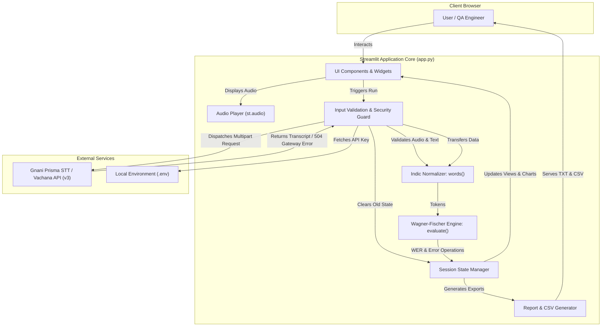
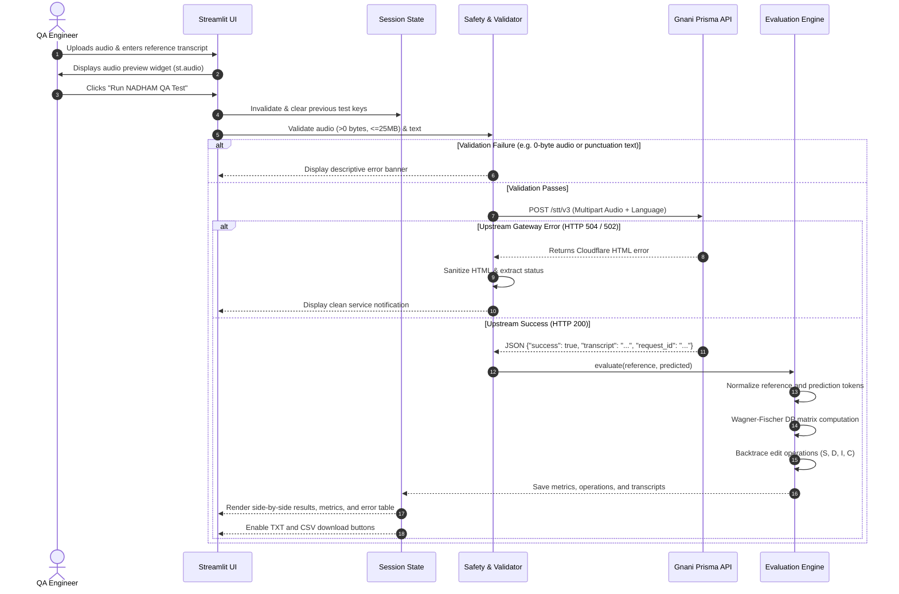

# 🏗️ NADHAM QA: Architecture & Design

This document details the software architecture, data pipelines, and design patterns implemented in **NADHAM QA**.

---

## 1. High-Level Architecture

NADHAM QA is structured as a reactive, single-page application utilizing Streamlit for user interaction, backed by an Indic NLP normalization pipeline, a dynamic programming evaluation engine, and a secure client for the Gnani Prisma STT API.

---

## 2. Tokenization & Indic Normalization Pipeline

Malayalam and Indian languages feature complex Unicode glyphs and control characters that require a deterministic pre-processing pipeline before calculating Levenshtein distance.

```mermaid
flowchart LR
    A["Raw Input Text"] --> B["1. Canonical Chillu Mapping<br/>(Legacy ZWJ -> Atomic)"]
    B --> C["2. Space Normalization<br/>(ZWSP \u200B, NBSP -> ' ')"]
    C --> D["3. Strip Isolated Control Chars<br/>(\u200C, \u200D)"]
    D --> E["4. Unicode NFC & Lowercase"]
    E --> F["5. Token Splitting (split)"]
    F --> G["6. Currency Normalization<br/>(Strip ₹, $, €, £)"]
    G --> H["7. Indian Number Formatting<br/>(Strip internal commas)"]
    H --> I["8. Boundary Punctuation Filter<br/>(Preserve Decimals & Dates)"]
    I --> J["Normalized Word Tokens"]
```

---

## 3. End-to-End Evaluation Sequence

The sequence diagram below traces an evaluation lifecycle, demonstrating defensive session management and error sanitization:

---

## 4. Component Architecture Breakdown

### 4.1 UI & Presentation Layer
- **Framework:** Streamlit `wide` layout.
- **Components:**
  - `st.selectbox`: Selection of target language (`Malayalam`, `English`, `Hindi`).
  - `st.file_uploader`: Multi-format audio upload supporting `.wav`, `.mp3`, `.ogg`, `.flac`, `.aac`, `.m4a`.
  - `st.audio`: Instant browser playback of uploaded audio.
  - `st.text_area`: Reference ground-truth transcript input.
  - `st.metric`: Three-card accuracy summary (Word Error Rate %, Word Errors, Reference Words).
  - `st.dataframe`: Word-level error diagnostics table.
  - `st.download_button`: Dual export buttons for plain text report (`.txt`) and tabular error breakdown (`.csv`).

### 4.2 Security & Defensive Boundaries
- **Zero-Byte Guard:** Intercepts 0-byte uploads before making external API requests.
- **Upload Cap:** Enforces a 25 MB limit to protect the host from in-memory Out-Of-Memory (OOM) exhaustion.
- **Session State Isolation:** Prevents stale metrics and transcripts from lingering on screen when an API call fails.
- **Error Sanitizer:** Shields users from raw HTML error pages generated by upstream proxies or web application firewalls.
- **Credential Protection:** API credentials (`GNANI_API_KEY`) are accessed strictly via `os.getenv` without logging or UI exposure.

### 4.3 Evaluation Engine (`evaluate()`)
- **Matrix Dimensions:** $(N+1) \times (M+1)$ where $N$ is reference word count and $M$ is hypothesis word count.
- **Unit Weights:**
  - Correct match: $cost = 0$
  - Substitution: $cost = 1$
  - Deletion: $cost = 1$
  - Insertion: $cost = 1$
- **Mathematical Invariant:** $\sum(\text{Substitutions} + \text{Deletions} + \text{Insertions}) = \text{Total Errors}$.
