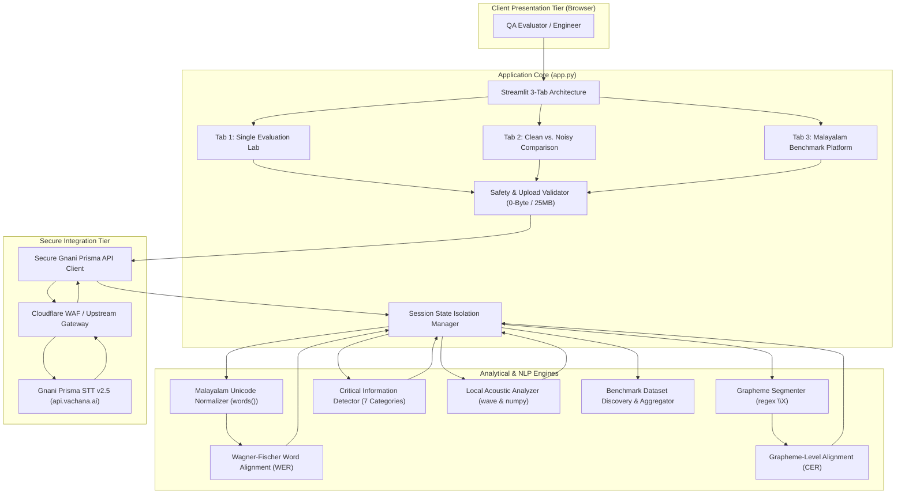
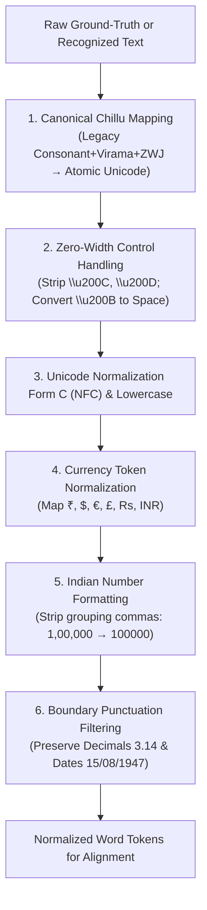
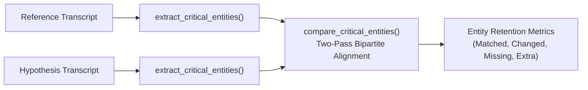

# 🏗️ NADHAM QA 2.0: System Architecture & Technical Design

This document details the software architecture, data pipelines, algorithmic design, and security engineering implemented in **NADHAM QA 2.0** (Kerala-First Indian Voice Intelligence Testing and Reliability Platform).

---

## 1. High-Level Architecture Overview

NADHAM QA 2.0 is structured as a reactive, three-tier analytical platform built on Streamlit, featuring modular NLP normalization pipelines, dual dynamic programming evaluation engines (WER and CER), a rule-based entity comparison system, a local acoustic signal analyzer, and a batch benchmark orchestrator connected securely to **Gnani Prisma STT (v2.5)** via the Vachana STT v3 endpoint.

---

## 2. Multi-Tab Functional Subsystems

The application organizes evaluation workflows into three specialized tabs:

### 2.1 Tab 1: Single Evaluation Lab (`🎙️ Single Evaluation`)
- **Purpose:** Deep-dive diagnostic evaluation of individual audio recordings.
- **Workflow:** Evaluates target audio against ground-truth text, computing Word Error Rate (WER), Character Error Rate (CER), Critical Information preservation, and detailed word-by-word alignment.
- **Diagnostics:** Interactive alignment table with colour-coded pills for Substitutions (Orange), Deletions (Red), and Insertions (Blue).
- **Export Formats:** Single-run comprehensive plain-text report (`.txt`) and tabular alignment (`.csv`).

### 2.2 Tab 2: Clean vs. Noisy Comparison Lab (`🔬 Clean vs. Noisy Comparison`)
- **Purpose:** Quantitative assessment of speech recognition degradation under background noise.
- **Workflow:** Ingests paired Clean and Noisy audio recordings against a shared ground-truth reference transcript. Dispatches two independent API calls and performs differential analysis:
  $$\Delta \text{WER} = \text{WER}_{\text{noisy}} - \text{WER}_{\text{clean}}$$
  $$\Delta \text{CER} = \text{CER}_{\text{noisy}} - \text{CER}_{\text{clean}}$$
- **Acoustic Analysis:** Locally parses PCM WAV headers and sample frames to extract signal duration, channels, sample rate, peak amplitude (dBFS), RMS level (dBFS), digital clipping percentage, and silence percentage.
- **Export Formats:** Comparative evaluation plain-text report (`.txt`) and comparative metrics table (`.csv`).

### 2.3 Tab 3: Malayalam Benchmark & Reliability Evidence (`📊 Malayalam Benchmark & Reliability Evidence`)
- **Purpose:** Systematic, reproducible batch evaluation across standard Malayalam speech datasets.
- **Workflow:** Discovers verified audio recordings and reference transcripts, executes batch evaluation across selected samples, tracks latency, and computes exact global aggregate metrics.
- **Acoustic Reality Guardrail:** Automatically inspects the dataset directory and transparently discloses that genuine paired clean/noisy audio is unavailable in the current repository, refusing to fabricate synthetic noise.
- **Export Formats:** Benchmark Summary TXT report, Sample-Level CSV, and Aggregate Metrics CSV.

---

## 3. Indic & Malayalam Text Normalization Architecture

Malayalam and Indian languages exhibit complex orthography, including legacy keyboard encoding differences and zero-width joiners. The normalization pipeline standardizes text deterministically:

### 3.1 The Malayalam Chillu Ambiguity
In Malayalam, chillu letters (`ൺ`, `ൻ`, `ർ`, `ൽ`, `ൾ`, `ൿ`) historically lacked atomic Unicode code points and were encoded as consonant + virama (`്`) + Zero-Width Joiner (ZWJ `\u200D`). Modern Unicode encodes them atomically (`\u0D7A` through `\u0D7F`). Because both sequences render identically on screen, naive string comparison falsely classifies them as substitution errors. NADHAM QA canonicalizes legacy sequences to atomic chillus prior to alignment.

---

## 4. Dual Evaluation Engines: WER & CER

### 4.1 Word Error Rate (WER) via Wagner-Fischer Dynamic Programming
- **Formula:**
  $$\text{WER} = \frac{S + D + I}{N_{\text{ref}}} \times 100\%$$
- **Operations Backtracking:** Backtraces the minimum-cost edit matrix from $(N, M)$ to $(0, 0)$ to reconstruct exact operation sequences:
  - Correct ($cost = 0$)
  - Substitution ($cost = 1$)
  - Deletion ($cost = 1$)
  - Insertion ($cost = 1$)
- **Invariant:** $S + D + I = \text{Total Word Errors}$.

### 4.2 Character Error Rate (CER) via Unicode Extended Grapheme Clusters
In Malayalam, characters are not individual Unicode code points. A base consonant combined with vowel signs (matras), virama, and modifier signs forms a single perceptual character unit (extended grapheme cluster).
- **Segmentation:** Employs the Python `regex` library with Unicode UAX #29 boundary matching (`\X`).
- **Whitespace & Punctuation Policy:** Spaces and punctuation marks are excluded from CER calculation to avoid artificially depressing or inflating error rates based on spacing discrepancies.
- **Formula:**
  $$\text{CER} = \frac{S_{\text{char}} + D_{\text{char}} + I_{\text{char}}}{N_{\text{graphemes}}} \times 100\%$$

---

## 5. Critical Information Detection & Entity Comparison

To evaluate whether domain-critical information is retained even when general transcription varies, NADHAM QA implements a deterministic, rule-based entity extraction and alignment pipeline across 7 categories:

### 5.1 Extraction Categories
1. **Numbers:** Decimal numbers (`3.14`), integer values, and Indian comma formatting (`1,00,000`).
2. **Dates:** Numeric patterns (`DD/MM/YYYY`, `DD-MM-YYYY`).
3. **Times:** 12-hour and 24-hour time expressions (`10:30 AM`, `18:00`).
4. **Currency:** Symbols and prefixes (`₹500`, `Rs 1,000`, `INR 50`).
5. **Phone Numbers:** 10-digit Indian mobile sequences and STD telephone numbers.
6. **Negations:** Explicit Malayalam negation words (`അല്ല`, `ഇല്ല`, `പാടില്ല`, `വേണ്ട`, `അരുത്`) and English negations (`not`, `no`, `never`, `cannot`).
7. **Known Named Entities:** Verified regional geographical locations (`തിരുവനന്തപുരം`, `കൊച്ചി`, `തൃശ്ശൂർ`, `കോഴിക്കോട്`) and person names.

### 5.2 Two-Pass Alignment Algorithm
1. **Pass 1 (Exact Identity Match):** Greedily pairs identical entities sharing both type and normalized value.
2. **Pass 2 (Changed Entity Pairing):** Pairs remaining unpaired reference and hypothesis entities of matching types, marking them as `Changed` (e.g., reference `500` vs recognized `5000`).
3. **Unpaired Remainders:** Classified as `Missing` (omitted from hypothesis) or `Extra` (hallucinated in hypothesis).

---

## 6. Local Acoustic Signal Analysis Architecture

To analyze audio properties without external heavy audio dependencies (e.g., ffmpeg or librosa), NADHAM QA natively parses PCM WAV audio via Python's standard `wave` and `numpy`:

- **Container Header Parsing:** Reads audio frames, sample rate ($F_s$), channels ($C$), sample width ($W$), and total frame count ($N_{\text{frames}}$).
- **RMS Energy:**
  $$X_{\text{RMS}} = \sqrt{\frac{1}{N} \sum_{i=1}^{N} x[i]^2}, \quad \text{RMS}_{\text{dBFS}} = 20 \log_{10}(X_{\text{RMS}} + \epsilon)$$
- **Peak Amplitude:**
  $$\text{Peak}_{\text{dBFS}} = 20 \log_{10}(\max |x| + \epsilon)$$
- **Digital Clipping:** Percentage of audio samples satisfying $|x[i]| \ge 0.999$.
- **Silence Percentage:** Evaluated across 20ms sliding windows ($0.02 \times F_s$ samples). A window is categorized as silent if its RMS level is below $-40\text{ dBFS}$.
- **Compressed Audio Safe Handling:** Formats like MP3 and M4A bypass local PCM decoding and report `supported=False`, preventing synthetic or inaccurate acoustic metrics.

---

## 7. Benchmark Batch Evaluation & Aggregation Architecture

### 7.1 Dataset Discovery & Double Extension Resolution
The benchmark dataset in `dataset/normal/` contains files with repeated extensions resulting from multi-step media conversions (e.g., `ML_NORMAL_01.mp3.mp3`), while reference transcripts in `dataset/transcripts/` are named `ML_NORMAL_01.mp3.txt`.
`extract_sample_id()` iteratively strips known extensions until reaching the root stem `ML_NORMAL_01`, ensuring robust pairing.

### 7.2 Exact Global Aggregate Metrics
In accordance with international speech recognition standards (e.g., NIST, Kaldi, Hugging Face evaluate), aggregate metrics are computed as exact global error quotients:
$$\text{Aggregate WER} = \frac{\sum_{i=1}^{K} \text{Word Errors}_i}{\sum_{i=1}^{K} \text{Reference Words}_i} \times 100$$
$$\text{Aggregate CER} = \frac{\sum_{i=1}^{K} \text{Char Errors}_i}{\sum_{i=1}^{K} \text{Reference Graphemes}_i} \times 100$$
- **Arithmetic Mean Rejection:** The unweighted average of individual sample error rates $\frac{1}{K}\sum \text{WER}_i$ is strictly avoided, as it distorts aggregate figures when sample lengths vary.
- **Partial Failure Isolation:** Samples encountering upstream network or API failures are categorized as `Failed` and excluded from successful aggregate error sums and reference totals.

---

## 8. Security & Enterprise Guardrails

1. **Dual-Source Credential Resolution:**  
   The application securely checks `os.getenv("GNANI_API_KEY")` followed by `st.secrets["GNANI_API_KEY"]`. API keys are never written to logs, source code, or exported reports.
2. **Pre-Flight Upload Validation:**  
   Rejects 0-byte audio files immediately, preventing wasted API quota. Enforces a 25 MB ceiling to prevent memory exhaustion (DoS).
3. **Session State Invalidation:**  
   Wipes previous evaluation keys upon initiating a new run, preventing stale metrics from persisting alongside failed calls.
4. **Upstream Gateway HTML Sanitization:**  
   Catches upstream HTTP 502/504 gateway timeouts (e.g., Cloudflare HTML pages) and extracts clean, safe status messages.
