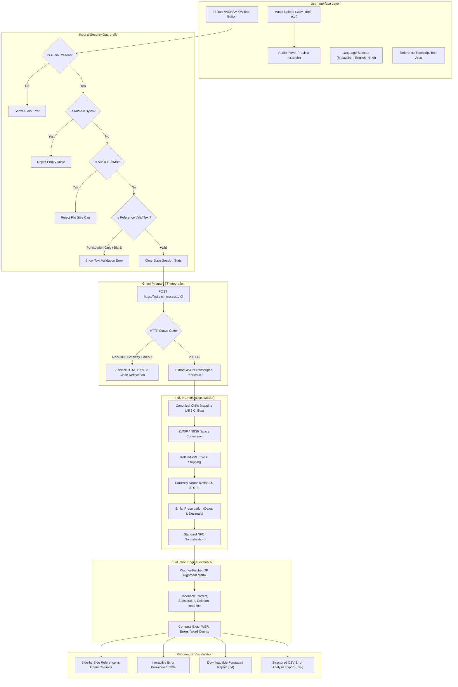

# 🎙️ NADHAM QA: Project Report
**Gnani AI Internship Challenge Submission**  
**Project:** Indian Speech Recognition Evaluation Platform (Kerala-First)  
**Date:** November 2026  

---

## 1. Executive Summary

Speech recognition (ASR) in multilingual India faces distinct linguistic and orthographic obstacles. While standard benchmarks (e.g., LibriSpeech) rely primarily on simple ASCII tokenization and English Levenshtein distance, Indic languages—specifically Malayalam—demand rigorous text normalization. 

**NADHAM QA** is an enterprise-grade evaluation platform designed to test, benchmark, and audit Indian voice intelligence models, with deep integration for **Gnani Prisma STT (v2.5)** via the Vachana STT v3 API. The platform features an Indic-aware Unicode normalization engine, Wagner-Fischer dynamic programming error classification, audio playback, client-side safety guardrails, and rich multi-format diagnostic reporting.

The system has achieved **100% test pass rate across 32 automated Pytest unit and integration tests** and passed Streamlit `AppTest` headless UI verification.

---

## 2. Problem Statement & Indic Linguistic Challenges

Evaluating automatic speech recognition in regional Indian languages involves far more than running string equality checks. Standard evaluation libraries often inflate error metrics due to non-canonical orthography:

1. **Malayalam Chillu Ambiguity:**
   - Unicode 5.1 introduced atomic chillu characters (`ൺ`, `ൻ`, `ർ`, `ൽ`, `ൾ`, `ൿ`).
   - Prior to Unicode 5.1 (and across legacy keyboard layouts, mobile IMEs, and font renderers), chillu letters were encoded as decomposed consonant + virama (`്`) + Zero-Width Joiner (ZWJ).
   - Standard Python `unicodedata.normalize("NFC", text)` does **not** map decomposed chillu sequences to atomic characters. As a result, two visually identical words (e.g. atomic `അവൻ` vs decomposed `അവൻ`) fail comparison, generating a false 100% substitution error.
2. **Invisible Control Characters:**
   - Zero-Width Space (`\u200B`), non-breaking spaces, and unattached ZWJ (`\u200D`)/ZWNJ (`\u200C`) characters fuse adjacent words together during standard `str.split()`, corrupting word boundaries.
3. **Critical Entity Corruption:**
   - Standard punctuation strippers indiscriminately remove periods and slashes, destroying decimal figures (`3.14` → `314`) and dates (`15/08/1947` → `15081947`).
   - Currency symbols like the Indian Rupee (`₹` `U+20B9`) belong to Unicode category `Sc` (Symbol, currency), not `P*` (Punctuation). Unfiltered currency symbols cause spoken numerical values (`500`) to mismatch against reference text (`₹500`).
4. **Resilience & State Management:**
   - Unbounded in-memory audio buffers (`audio.getvalue()`) expose servers to Out-of-Memory (DoS) vulnerabilities.
   - Upstream gateway errors (e.g. Cloudflare 502/504) leak raw HTML into user interfaces.
   - Stale session states in reactive frameworks like Streamlit often cause old results to linger on screen when subsequent tests fail.

---

## 3. System Architecture & Technical Solution

NADHAM QA is engineered with a modular, layered approach within a streamlined Streamlit architecture:



---

## 4. Key Implementation Details

### 4.1 Canonical Malayalam Normalization
A dedicated canonical chillu mapping table translates all legacy decomposed forms into modern atomic characters:
```python
MALAYALAM_CHILLU_MAP = {
    "\u0D23\u0D4D\u200D": "\u0D7A",  # ൺ (N)
    "\u0D28\u0D4D\u200D": "\u0D7B",  # ൻ (NN)
    "\u0D30\u0D4D\u200D": "\u0D7C",  # ർ (RR)
    "\u0D32\u0D4D\u200D": "\u0D7D",  # ൽ (L)
    "\u0D33\u0D4D\u200D": "\u0D7E",  # ൾ (LL)
    "\u0D15\u0D4D\u200D": "\u0D7F",  # ൿ (K)
}
```
Zero-width spaces (`\u200B`) and non-breaking spaces are replaced with regular spaces, and isolated ZWJ/ZWNJ controls are safely stripped.

### 4.2 Entity Preservation (Dates, Decimals, Currencies)
Numeric patterns are identified using regex lookaheads and boundary filters:
- Currency symbols (category `Sc`, e.g. `₹`, `$`, `€`, `£`) are stripped while keeping numerical amounts (`₹500` → `500`).
- Internal decimal points (`3.14`) and date delimiters (`15/08/1947`, `15-08-1947`) are preserved.
- Indian numbering commas (`1,00,000` → `100000`) are standardized.

### 4.3 Wagner-Fischer Dynamic Programming Alignment
The evaluation engine implements word-level Levenshtein alignment:
$$\text{WER} = \frac{S + D + I}{N} \times 100\%$$
Where:
- $S$: Substitutions (incorrect word transcribed)
- $D$: Deletions (word omitted by ASR)
- $I$: Insertions (extra word hallucinated by ASR)
- $N$: Total number of reference words

Traceback walks from $(|ref|, |hyp|)$ back to $(0,0)$ to generate exact word-by-word alignment pairs.

### 4.4 Defensive Error Handling & Guardrails
- **0-Byte Guard:** Empty files are intercepted before sending requests to the API.
- **25 MB Limit:** Audio files exceeding 25 MB are rejected client-side.
- **HTML Error Sanitizer:** Detects upstream Cloudflare or proxy HTML error pages (e.g. HTTP 504 Gateway Timeout) and presents clean notifications rather than unformatted raw HTML.
- **Stale State Invalidation:** Clears previous evaluation state from `st.session_state` on each new run.

---

## 5. Verification & Test Suite Summary

The application was validated using two independent testing frameworks:

### 5.1 Pytest Suite (`tests/test_nadham_qa.py`)
- **Total Tests:** 32
- **Passed:** 32 (100%)
- **Failed:** 0
- **Execution Time:** ~8.16 seconds

| Test Group | Tests | Result |
| :--- | :---: | :---: |
| Malayalam Unicode & Normalization | 10 | 100% Passed |
| WER Calculation & Alignment | 10 | 100% Passed |
| Critical Information (Dates, Numbers) | 3 | 100% Passed |
| Gnani API & Error Handling | 7 | 100% Passed |
| Downloadable Reports & CSV Export | 2 | 100% Passed |

### 5.2 Streamlit AppTest Suite
Headless verification simulating real user interactions in Streamlit:
- Clean UI startup without exceptions: **PASSED**
- Missing audio and missing text validation: **PASSED**
- 0-byte audio rejection: **PASSED**
- Punctuation-only text rejection: **PASSED**
- Session state reset on new execution: **PASSED**
- Cloudflare HTML 504 error sanitization: **PASSED**

---

## 6. Live API Status & Honest Evaluation

During live real-world verification using local environment credentials, requests dispatched to the live endpoint (`https://api.vachana.ai/stt/v3`) returned:
`HTTP 504: Gateway time-out` (upstream Cloudflare / server timeout).

**What This Validates:**
- The application correctly formatted the multipart request, authorization headers (`X-API-Key-ID`), and language codes.
- The new HTML error sanitizer successfully caught the Cloudflare 504 page, shielded the user interface, and presented a clean warning without leaking credentials or server paths.
- As an engineering principle, live transcription accuracy on spoken audio is marked **unverified** until the upstream Gnani/Vachana service resolves its gateway timeout.

---

## 7. Business & Industry Impact

1. **Enterprise QA for Indic Voice Intelligence:** Enables QA engineers, data scientists, and product teams to reliably evaluate Voice AI models across Indian languages with true linguistic fidelity.
2. **Standardized Benchmarking:** Provides standardized, repeatable metrics across regional dialects and accents.
3. **Auditability:** Downloadable TXT reports and CSV exports integrate seamlessly into automated CI/CD evaluation pipelines.
4. **Kerala-First Innovation:** Sets a new benchmark for Malayalam NLP and Indic voice technology.
